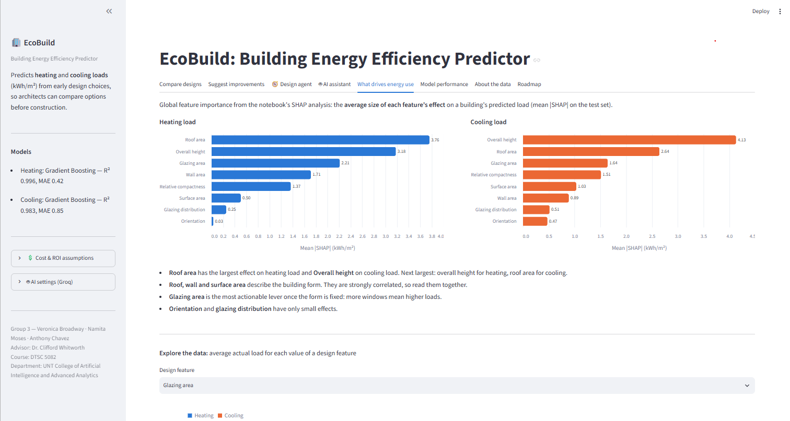

# EcoBuild — Building Energy Efficiency Predictor

**A school project for DTSC 5082 at the University of North Texas.**

EcoBuild helps architects compare early building designs before construction begins. It predicts heating and
cooling energy loads from eight design features, explains what drives the difference between designs, and turns the
predictions into cost, payback and CO₂ estimates.



*The EcoBuild app: which design features drive heating and cooling load (mean |SHAP| values).*

## Project team

- **Team members:** Anthony Chavez, Namita Moses, Veronica Broadway
- **Course:** DTSC 5082 (Fall, 2026)
- **Professor:** Clifford Whitworth
- **School:** University of North Texas

## What the app does

EcoBuild compares early-stage building designs. For each design it predicts **heating load**, **cooling load**
and **total load** (kWh/m²) with Gradient Boosting models, shows a typical error range for every prediction,
explains the differences with **SHAP**, and suggests orientation and window changes for a chosen building form.

It also helps people **decide**, not just predict:

- **Business view:** turns predicted loads into annual energy cost, envelope construction cost, payback, NPV and CO₂,
  with the model's error carried through to every dollar figure. All assumptions are editable in the sidebar.
- **🧭 Design agent:** evaluates all 768 designs the model knows against an architect's constraints (stories, fixed
  orientation, daylight/window limits, construction budget) and a goal (lowest energy, best value, lowest
  construction cost, lowest CO₂). It logs every step, keeps the cost-vs-energy Pareto frontier, stress-tests the pick
  against ±25% construction costs, explains it with SHAP and writes a decision memo.
- **🤖 AI assistant:** answers plain-English questions with a Groq-hosted LLM that **calls EcoBuild's own tools**
  (predict, compare, suggest improvements, run the design agent, feature importance, model info). Numbers come only
  from those tools; each answer shows the tool calls behind it.

This repository also contains the notebooks behind the research paper
*Testing on Unseen Designs: How Validation Strategy Affects Reported Accuracy in Building Energy Load Prediction*.

## How to run

**Requirements:** Python 3.11 or newer (tested on 3.12 and 3.13) and Git.

1. **Get the code**

   ```bash
   git clone https://github.com/ammchavez-netizen/ecobuild-app.git
   cd ecobuild-app
   ```

2. **Create and activate a virtual environment**

   Windows (Command Prompt or PowerShell):

   ```bash
   py -m venv .venv
   .venv\Scripts\activate
   ```

   macOS / Linux:

   ```bash
   python3 -m venv .venv
   source .venv/bin/activate
   ```

   If PowerShell blocks `activate` with a "running scripts is disabled" error, run
   `Set-ExecutionPolicy -Scope CurrentUser RemoteSigned` once, then activate again.

3. **Install the packages**

   ```bash
   pip install -r requirements.txt
   ```

4. **Start the app**

   ```bash
   streamlit run app.py
   ```

   The app opens in your browser at http://localhost:8501. Press **Ctrl+C** in the terminal to stop it, and run
   `deactivate` to leave the virtual environment.

5. **Optional: turn on the AI assistant.** Add a free Groq API key, as described in
   [Turn on the AI assistant](#turn-on-the-ai-assistant). Without a key, every tab works except the chat, the brief
   reader and the AI-written summary.

**Run the tests (optional):**

```bash
pip install pytest
pytest
```

**Notes**

- The first start takes a few seconds while the models and the SHAP explainer load.
- The trained models are in `models/`. If your scikit-learn version cannot load them, the app retrains them
  automatically from `models/ENB2012_data.csv` with the same settings and shows a note in the sidebar.

## Files

| Path | What it is |
|---|---|
| `app.py` | The Streamlit app (8 tabs: Compare designs · Suggest improvements · Design agent · AI assistant · What drives energy use · Model performance · About the data · Roadmap) |
| `ecobuild_core.py` | Feature engineering, model loading, prediction, SHAP and design suggestions |
| `ecobuild_econ.py` | Cost model: energy cost, CO₂, envelope construction cost, payback, NPV, uncertainty |
| `ecobuild_agent.py` | Design agent: candidate generation, constraints, Pareto frontier, ranking, sensitivity, SHAP reasons |
| `ecobuild_ai.py` | Groq LLM assistant: tool definitions, tool runtime, chat loop, brief parsing, memo writing |
| `tests/` | Unit tests (economics, agent, tools, chat loop with a mocked LLM) — run `pytest` |
| `models/` | Model bundle used by the app (trained and tested on whole held-out designs) |
| `notebooks/EcoBuild_Paper_Figures.ipynb` | Reproduces every figure and table in the research paper |
| `notebooks/EcoBuild_Update3_Grouped_Validation.ipynb` | Whole-design validation, model tuning and the bootstrap comparison; exports the model bundle |
| `dataset/ENB2012_data.xlsx` | The UCI Energy Efficiency dataset |
| `requirements.txt` | Python packages |
| `.streamlit/config.toml` | Theme |
| `.streamlit/secrets.toml.example` | Template for the Groq API key |

## Turn on the AI assistant

1. Get a free API key at [console.groq.com/keys](https://console.groq.com/keys).
2. **Locally:** copy `.streamlit/secrets.toml.example` to `.streamlit/secrets.toml` and paste the key.
   **Streamlit Community Cloud:** App settings → Secrets → paste `GROQ_API_KEY = "gsk_..."`.
   You can also paste a key in the sidebar (**🤖 AI settings**) for the current session only.
3. Without a key, everything works except the chat, the brief reader and the AI-written summary.

The default model is `openai/gpt-oss-120b` (Groq retired `llama-3.3-70b-versatile` from free and Developer plans on 2026-08-16). The sidebar lists the models your key can use, and if a model is retired the assistant falls back to `openai/gpt-oss-20b` or `qwen/qwen3.6-27b` automatically.

## Cost assumptions (planning estimates)

| Assumption | Default | Source / status |
|---|---|---|
| Electricity price | $0.140 / kWh | EIA Short-Term Energy Outlook (Oct 2026), U.S. commercial, 2026 forecast |
| Natural gas price | $11.46 / thousand cubic feet | EIA Short-Term Energy Outlook (Oct 2026), U.S. commercial, 2026 forecast |
| Heating / cooling equipment | gas furnace 90%, heat pump COP 3, AC COP 3 | typical values, editable |
| Grid CO₂ | 0.37 kg / kWh | approx. U.S. average (EPA eGRID), editable |
| Wall / window / roof / foundation / upper floor | $250 / $650 / $200 / $180 / $150 per m² | **placeholders**, replace with real cost data |

Floor area, glazing area and envelope quantities come from the dataset's geometry (surface area = walls + 2 × roof,
so the footprint equals the roof area). Loads are treated as annual kWh per m² of floor area.

## Reproduce the research paper

1. Open `notebooks/EcoBuild_Paper_Figures.ipynb` in Google Colab or Jupyter.
2. In Colab, upload `ENB2012_data.xlsx` when asked. In Jupyter, copy `ENB2012_data.xlsx` (from `dataset/`) into the same folder as the notebook.
3. Run all cells.
